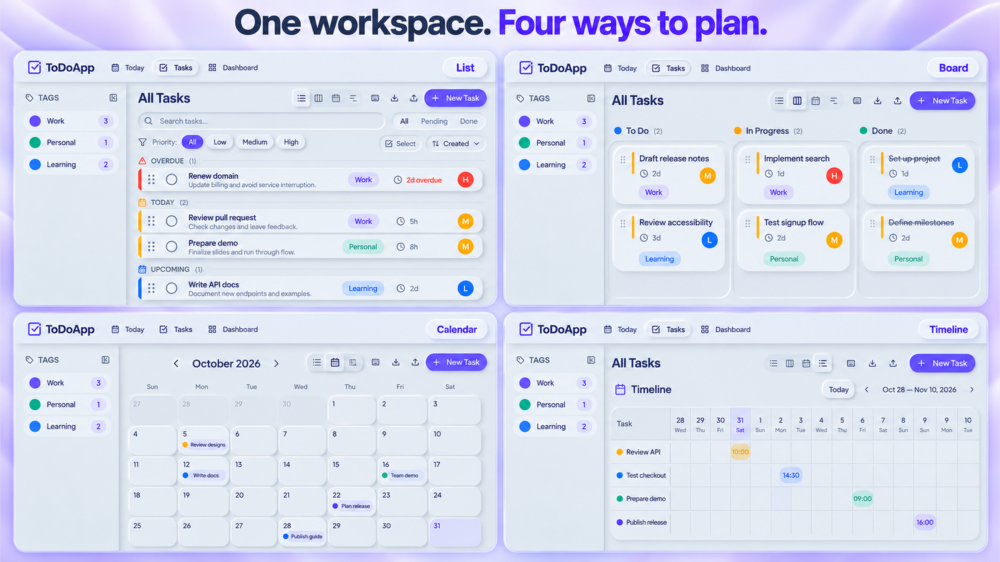
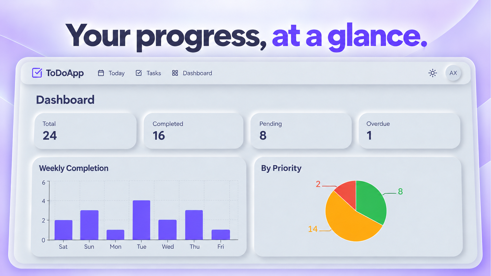
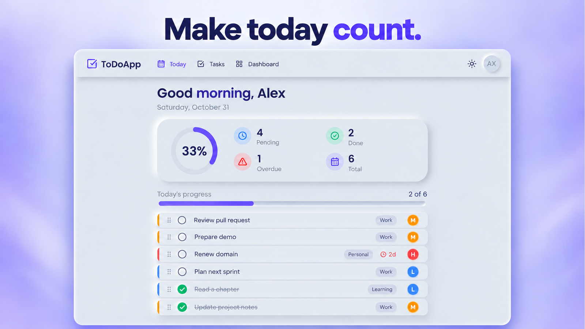

# ToDoApp

A personal task manager with a soft neumorphic interface, four task views, subtasks, comments, and built-in time tracking. Built with Next.js and FastAPI.

## App previews

Three images show the app: the combined task displays, Dashboard, and Today. These promotional illustrations follow the real screenshots and use original sample tasks.

### List, Board, Calendar, and Timeline



### Dashboard



### Today



## Features

- **Organize:** color-coded tags, priorities, pins, search, status filters, and bulk selection.
- **Plan:** switch between a task list, Kanban board, monthly calendar, and deadline timeline.
- **Work through the details:** add subtasks and comments, duplicate tasks, and start or stop a task timer.
- **Repeat:** completing a recurring task can create its next daily, weekly, or monthly instance up to an end date.
- **Review:** a Today page, summary counts, weekly completion chart, and priority breakdown.
- **Personalize:** light, dark, and system themes; collapsible tag sidebar; keyboard shortcuts.
- **Transfer:** JSON task export/import. Task templates and manual time logging are also available through the API.

## Run locally

Use Python 3.12+ and Node.js 24 (version 24.15 or later). The component test dependencies require this newer Node.js version.

### 1. Start the API

```bash
cd backend
python -m venv venv
# macOS / Linux
source venv/bin/activate
# Windows PowerShell: .\venv\Scripts\Activate.ps1
pip install -r requirements.txt
```

Copy `backend/.env.example` to `backend/.env`. Generate a key and replace the example `SECRET_KEY`:

```bash
python -c "import secrets; print(secrets.token_hex(32))"
```

From `backend/`, run:

```bash
uvicorn app.main:app --reload --host 127.0.0.1 --port 8000
```

The API creates missing tables on startup. It does not migrate an existing database schema.

### 2. Start the frontend

In another terminal:

```bash
cd frontend
npm ci
npm run dev
```

Open <http://localhost:3000> and create an account. API documentation is at <http://localhost:8000/docs>.

After completing setup, Windows users can launch both services with `run.bat`. The launcher does not install dependencies or forcibly free occupied ports.

### Configuration

| Variable | Location | Purpose |
| --- | --- | --- |
| `SECRET_KEY` | `backend/.env` | Required signing secret, at least 32 characters |
| `DATABASE_URL` | `backend/.env` | Defaults to `sqlite:///./todoapp.db` |
| `ACCESS_TOKEN_EXPIRE_MINUTES` | `backend/.env` | Token lifetime, default 1440 minutes |
| `CORS_ORIGINS` | `backend/.env` | JSON array of permitted frontend origins |
| `FORCE_HTTPS` | `backend/.env` | Redirect HTTP requests to HTTPS; default `false` |
| `NEXT_PUBLIC_API_URL` | `frontend/.env.local` | API URL; defaults to `http://localhost:8000` |

The frontend API URL is embedded at build time. A deployment change requires rebuilding the frontend. PostgreSQL deployments also need a matching database driver; none is bundled.

## Architecture

| Path | Responsibility |
| --- | --- |
| `backend/app/main.py` | App lifespan, middleware, errors, and router registration |
| `backend/app/config.py`, `database.py` | Environment settings and database sessions |
| `backend/app/models.py`, `schemas.py` | SQLAlchemy models and request/response validation |
| `backend/app/services/tasks.py` | Task serialization and recurring deadline calculation |
| `backend/app/routers/` | Account, task, tag, timer, template, and dashboard endpoints |
| `frontend/src/app/` | Next.js routes and page state |
| `frontend/src/components/` | Task views, forms, navigation, charts, and UI primitives |
| `frontend/src/hooks/use-auth.tsx` | Account session state |
| `frontend/src/lib/` | API client, shared types, and utilities |

The browser calls the FastAPI service directly. Requests carry a bearer token; database queries scope task data to the authenticated account. SQLite is the default local database.

## Checks

```bash
cd backend
pip install -r requirements-dev.txt
python -m pytest tests -q
```

```bash
cd frontend
npm test
npx tsc --noEmit
npm run lint
npm run build
```

The maintenance review passed 17 backend regression tests, three completion-control component tests, and TypeScript checking. Frontend lint still reports existing React hook/compiler and unused-code issues. Production builds could not complete in the review environment because Node reported `ENOENT: uv_resident_set_memory`; a browser walkthrough and production build still need verification. See [review notes](docs/MAINTENANCE.md).

## Current boundaries

- JSON transfer includes task fields and tag names. It does not include account data, comments, subtasks, timer history, or original tag colors.
- The timeline shows deadline markers, not task durations or dependencies.
- The Today view includes tasks due today and overdue tasks from the preceding seven days, using UTC boundaries.
- Weekly completion groups completed tasks by their latest update timestamp; it is not a completion event log.
- Template endpoints and a manual time-log endpoint exist; their full workflows are not exposed in the current task page.
- Authentication uses localStorage bearer tokens. Rate limiting is per process and needs a shared implementation for multi-worker deployments.
- Existing deployments need a migration plan, HTTPS, appropriate proxy trust, and backup configuration. No Alembic migration history is included.

## Banner assets

The four task displays share one **3840 × 2160** RGB PNG banner. Today and Dashboard each have a separate **1600 × 900** banner. `docs/images/social-preview.png` is **1280 × 640**, suitable for the repository social preview setting. The README references each feature banner once. Design notes and generation prompts are in [BANNERS.md](docs/BANNERS.md).
